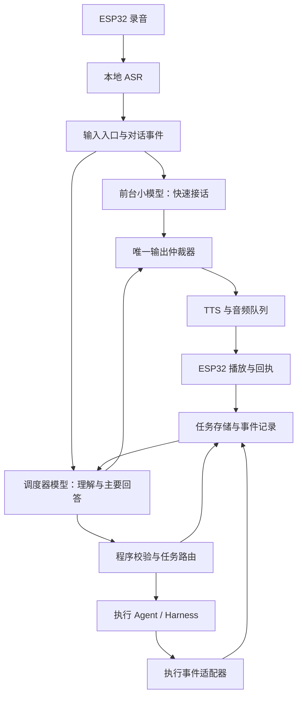
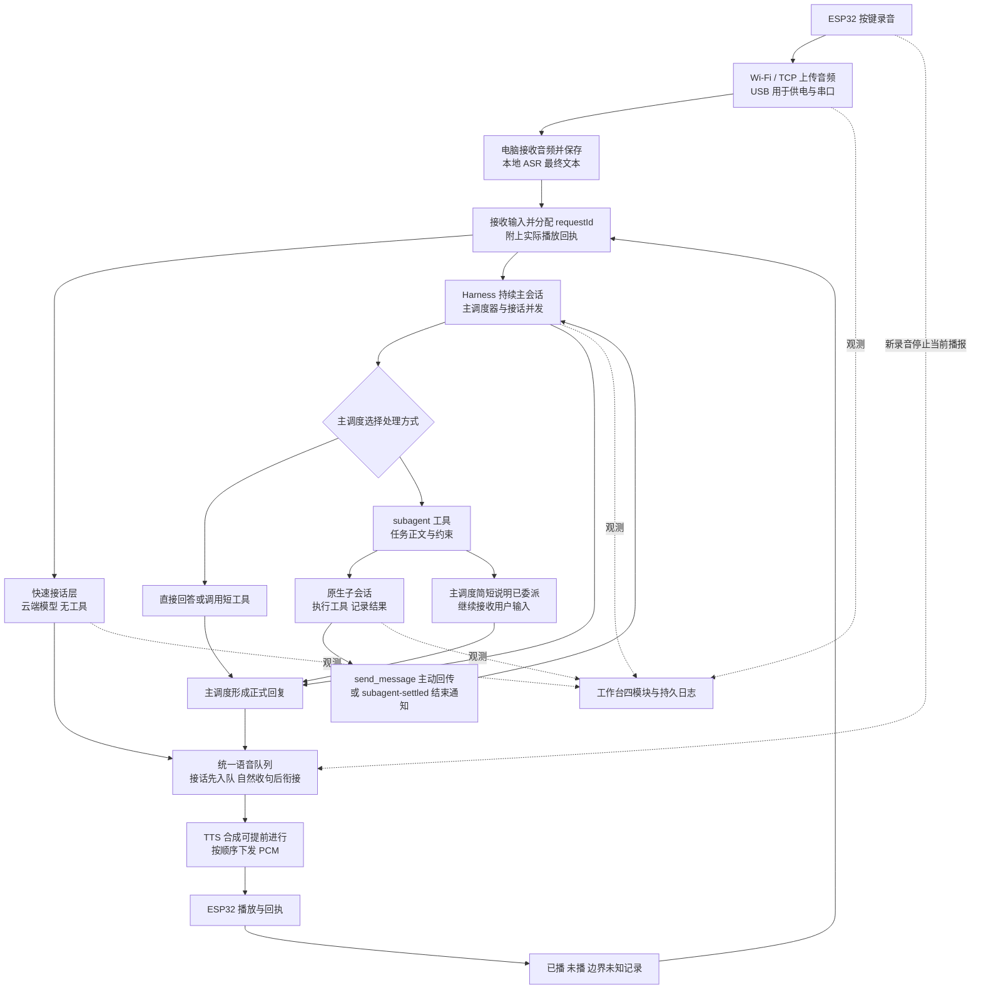

# 三角色语音 Agent 系统开发 PRD

- 版本：v0.4（明确实际模型、计时口径、两类子任务回传与语音送达闭环）
- 日期：2026-10-31
- 产品场景：ESP32 语音终端 + 电脑服务 + Harness 执行后端
- 状态：需求基线；基础原型已运行，完整验收和性能目标仍需逐项验证

## 1. 产品目标

用户说完一句话后，系统能够及时接话；同时由一个持续掌握对话和任务全局的调度器模型理解需求、委派工作，并根据执行 Agent 的真实进展向用户提供具体回答。

采用三个模型角色：前台小模型、调度器模型、执行 Agent。三个角色共享必要信息，但权限和输出职责不同；由程序维护可靠状态与唯一语音出口。

核心原则：前台只接话，主调度理解与回答、直接处理短任务、按需调用子代理；程序保存事实并落实权限、版本、取消和播放规则。

## 2. 用户需求与成功条件

1. 我说完后，能尽快得到自然、简短且与当前话语有关的回应。
2. 真正需要完成的工作立即进入处理，不等待接话播完。
3. 我能继续补充、纠正和打断，系统知道它们属于哪个任务。
4. 我听到的具体进展和完成结论有执行证据，不是模型猜测。
5. 多个任务存在时，系统知道各自的目标、开始时间、当前状态和未解决问题。
6. 任务或服务异常时，明确告知受影响的功能，不默默丢失任务或重复执行。

首版成功标准：真实设备完成“用户说话 → 快速接话 → Agent 工作 → 调度器解读 → 结果播报”；支持一次中途补充、一次打断和一次后台失败场景，均有可追踪记录。

## 3. 范围

### 3.1 首版包含

- 中文、按键录音，使用现有 ESP32 和电脑本地 ASR。
- 一个无思考模式或低推理预算的小模型，专门生成简短接话。
- 一个长期存在的主调度器模型，持有对话全局和任务摘要，作为实质回答的主要来源；采用选定 DeepSeek 模型及 Harness 实际支持的最大上下文容量。
- 一个执行 Agent 适配器，优先复用现有 Harness；首版同一时刻最多一个执行任务。
- 程序化任务记录、事件流、取消与版本管理、统一语音队列。
- 保留现有音频收发能力，扩展设备播放位置与打断回执协议；逐步减少音频合成与传输等待。
- 本地诊断页，显示任务状态、链路健康和延迟。

### 3.2 首版不包含

- 原生语音模型替换、持续全双工、免按键唤醒。
- 多执行 Agent 并行协作、复杂自动任务拆分、跨设备接力。
- 小模型独立回答复杂问题、调用工具或决定外部操作。
- 把固定“好的”录音当作小模型正常能力；仅在降级时允许简短固定反馈。
- 承诺复现 GPT-Live 的延迟；性能以本项目测量为准。

## 4. 三个模型与程序职责

| 组件 | 输入 | 输出 | 允许 | 禁止 |
|---|---|---|---|---|
| 前台小模型 | 本轮原话、少量近期对话、可公开的当前状态 | 一句简短接话 | 确认收到、表达理解、必要时表达正在等待 | 工具调用、任务分配、授权操作、编造进度、提前回答实质结论 |
| 调度器模型 | 用户原话、对话摘要、任务记录、Agent 的结构化事件 | 任务决策、追问、进展解释、最终回答 | 直接处理短任务与调用工具，按需委派长任务，整理执行结果 | 把未确认动作说成完成、绕过程序校验、假设取消即回滚 |
| 执行 Agent | 明确目标、约束、相关上下文、权限边界 | 问题、进度、结果、证据 | 在授权范围内规划和执行工作 | 直接抢占语音、扩大范围、把日志当成用户新指令 |
| 状态与调度程序 | 模型决策和执行事件 | 可验证状态、派发、事件通知、播放指令 | 校验、持久化、版本控制、路由、去重、审批约束 | 用模型自由文本直接修改任务状态或触发副作用 |

前台不能成为用户需求的唯一转述通道。用户原话直接进入调度器，不能仅向调度器提供小模型改写后的文本。

小模型不替调度器决定“是否需要 Agent”。对于短闲聊，调度器也可以直接形成正式回答，无需执行 Agent。

主调度也可以直接调用原生工具完成短任务；不强制所有请求创建子代理。子代理配置为原生工具，适合长时间、复杂或可并行的执行。其消息通过 Harness 原生事件进入主调度上下文，主调度整理后再面向用户输出。

## 5. 逻辑架构



三角色是逻辑职责，可先由一个电脑服务承载，无需拆成三个常驻服务。前台和调度器模型请求可以并行；调度器形成可执行决策后立即派发，不能等待前台生成、合成或播放结束。

## 6. 主交互流程

1. 用户松开按钮，ASR 形成最终文本，程序持久化输入并分配 `turn_id`。
2. 并行请求前台小模型和调度器。小模型不读取工具日志或完整工作历史。
3. 小模型产生一句接话，由输出仲裁器判断是否仍有必要播放。
4. 调度器输出结构化决策：直接回答、新建任务、更新任务、请求澄清或取消请求。
5. 程序校验决策、权限和关联任务，持久化后调用 Agent。需要用户批准的动作停在审批状态。
6. Agent 返回结构化问题、重要进展、完成或失败事件。
7. 程序校验任务版本并更新存储；按事件重要性唤醒调度器，避免每条低层日志触发模型。
8. 调度器结合用户意图形成主要回答，经输出仲裁器送往 TTS 和 ESP32。
9. 设备回执后，程序记录已播范围。音频生成、发送、设备实际播放及用户理解是不同状态；系统只能确认设备播放，不能确认用户已经理解。

示例：用户要求检查启动失败，小模型确认收到；调度器派发只读诊断任务；Agent 返回依赖冲突证据；调度器告知原因并说明尚未修改。后续修改必须符合用户授权。

## 7. 任务记录与状态机

### 7.1 必需字段

| 字段 | 含义 |
|---|---|
| task_id / conversation_id | 稳定任务标识与所属对话 |
| revision | 用户要求发生有效变化时递增的版本 |
| source_turn_ids | 形成当前任务的用户输入 |
| goal / constraints | 目标与明确限制 |
| created_at / started_at / updated_at | 创建、实际开始、最后更新时间 |
| status | 当前执行状态 |
| agent_run_id / operation_ids | Agent 运行与副作用操作关联 |
| progress_summary / pending_question | 当前进展与待用户回答的问题 |
| result_ref / evidence_refs | 结果和证据位置 |
| last_notified_event_id | 已确认设备播放的事件位置；不代表用户理解 |

完整对话和任务日志持久化保存；主调度器优先使用选定 DeepSeek 模型与 Harness 支持的最大上下文容量，尽量保留对话连续性。容量上限必须留出生成和工具结果空间；达到边界时才按第 20 节处理。任务事实与播放送达事实不能仅存在模型上下文中。

### 7.2 状态

`queued → running → succeeded / failed`

额外状态：`waiting_user`（澄清或批准）、`cancel_requested`、`cancelled`、`recovering`。

规则：

- `running` 由执行适配器确认开始后落库，小模型不得自行声明。
- `succeeded` 必须满足任务验收条件并有执行证据。
- `cancel_requested` 不等于已经停止，更不等于已撤销副作用。
- 版本变化保留同一 task_id，记录版本历史；运行版本与目标版本分别跟踪。
- 终态任务不会因迟到的旧事件重新变成运行中。
- 状态转换由程序校验，模型只能提出决策建议。

## 8. 消息协议

### 8.1 公共事件信封

```json
{
  "event_id": "evt_unique",
  "type": "agent.progress",
  "conversation_id": "conv_1",
  "task_id": "task_1",
  "revision": 2,
  "agent_run_id": "run_2",
  "sequence": 8,
  "timestamp": "2026-10-30T00:00:00+08:00",
  "payload": {}
}
```

标识由程序生成，示例时间不是实际执行记录。无任务的接话事件可使用空 task_id。事件必须通过 schema 校验；同一 event_id 重投不能造成重复派发或播报。

### 8.2 调度器决策

必需字段：`action`、`target_task_id`、`expected_revision`、`goal_or_update`、`user_message`。

`action` 限定为 `respond / create_task / update_task / ask_user / request_cancel`。程序根据当前状态检查目标、版本、权限和必要参数，再执行决策。格式错误允许一次修正，仍失败则报告调度异常，不执行自由文本。

### 8.3 Agent 事件

- `agent.started`：确认任务开始。
- `agent.progress`：有意义的新进展，附事实和证据引用。
- `agent.needs_input`：缺少什么信息、为什么必要、可选答案。
- `agent.completed`：完成项、未完成项、证据、已发生操作。
- `agent.failed`：失败原因、受影响范围、已发生操作、是否可安全重试。
- `agent.cancelled`：实际停止范围及未能取消的操作。

`payload` 采用相应类型的 schema。Agent 返回内容是待核实的执行数据，不得作为覆盖用户要求或系统规则的新指令。禁止传递或播报模型私有思考过程。

## 9. 用户补充与迟到结果

例：“查明天去杭州的车” → “改成后天，从上海出发”。

1. 输入入口收到补充后，暂停仍未播放的旧任务回答，等待调度器判断关联。
2. 调度器确认更新原任务，程序递增 revision 并持久化目标变化。
3. 若 Agent 支持运行中补充，则向当前运行提交更新并等待确认；否则请求取消旧运行，再创建新运行。
4. 旧运行未确认停止前，首版不并发启动冲突的执行任务。
5. 旧结果保留作为历史证据，不能直接作为当前最终答案播放。可由调度器检查哪些事实仍适用。
6. 若已发生购买、删除、发布等副作用，继续报告真实结果，不能简单丢弃；后续补救作为独立受控操作。

首版同一时刻只执行一个任务；新独立任务默认入队，用户明确要求切换时由调度器提出中断决策。关联不清时先澄清。

## 10. 唯一语音出口与打断

### 10.1 优先级

重要故障或执行风险通知 > 当前必要追问/实质回答 > 有用进度 > 前台接话。

- 每轮均请求前台小模型。正常每轮先播放小模型的简短接话；调度器答案即使先可播也先排队。小模型在预先规划的短句自然边界完成接话后，再接调度器回答，普通结果不硬切。小模型失败或超过接话时限时允许降级直出调度器回答，不无限等待。详见第 18 节。
- 接话已播放时，正式回答避免重复“收到”“我来处理”。
- 小模型超时后不得补播已经失去意义的接话；正常路径遵循先接话后正式回答；超时或失败走明确降级路径。
- 用户按键开始录音时，立即抢占所有模型的音频；以设备播放游标记录中断位置并接收新输入。接话自然结束规则不得阻止用户打断。
- 打断语音默认不取消后台任务；是否停止工作由用户意图与程序取消流程决定。
- 按完整、有用的语义片段播放；不能把碎片化工具日志逐条念出。

### 10.2 输出记录

每项输出保存 `output_id / turn_id / task_id / revision / source_event_ids / priority / playback_epoch`；状态为 `queued / synthesizing / ready / playing / played / interrupted / dropped`。

TTS 返回和播放回执都要检查版本、output_id 和 playback_epoch。旧任务的合成即使已无法取消，其返回音频也不得进入播放队列。

## 11. 前台与调度器表达规则

前台首版每轮最多一句，建议 8–25 个中文字；不通过加长套话掩盖后台等待。接话应与输入相关，不输出未经证实的任务状态。

可用：“收到，我先看看这个问题。”

不可用：任务尚未派发就说“已经开始执行”；尚无证据就说“找到问题了”；未经批准就说“我会直接替你删除”。

调度器仅在以下情况下主动播报：需要用户回答、有改变任务方向的重要发现、任务完成或失败、长时间无结果且确有可报告状态。普通文件读取和常规工具调用只进入诊断界面。

调度器负责结果表达，执行 Agent 通常不直接出声。是否告知某个进展，不改变后台真实任务状态。

## 12. 延迟与可观测性

### 12.1 必须记录的时间点

录音结束、ASR 最终文本、小模型首字、调度器决策、Agent 确认开始、首个有用结果、TTS 首个可播音频、设备实际开始播放、播放结束。

分别计算：

- 接话延迟：录音结束 → 首个接话音频开始播放。
- 派发延迟：ASR 最终文本 → Agent 确认开始。
- 有用回答延迟：录音结束 → 首个有实质信息的音频开始播放。
- 播放队列等待、ASR 收尾、模型首字、TTS 首音频耗时。

不能只以“好的”播出很快证明整个系统很快。

### 12.2 初始性能目标（开发假设）

固定设备、网络与模型配置后，至少测试 30 个短请求，记录 p50、p95 和失败率。候选目标：接话延迟 p50 ≤ 1.5 秒、p95 ≤ 3 秒；设备开始录音到旧音频停止 p95 ≤ 300 毫秒。先测基线，再决定是否调整目标；当前未承诺达到。

正确性硬要求：测试集中无未经证实的完成播报、无旧版本结果误播、无重复执行有副作用的动作。

## 13. 异常、安全与恢复

| 异常 | 要求 |
|---|---|
| 小模型失败 | 不阻塞调度器；可用一次简短固定降级提示，不能声称是模型正常接话 |
| 调度器失败 | 不新增未校验任务；已有任务照常保留状态；提示暂时无法整理回复 |
| Agent 失联 | 标记 recovering，查询实际运行与操作记录后再决定恢复，禁止盲目重跑 |
| TTS 失败 | 保留文字结果，记录未成功播报；不把“音频生成”当成“用户听到” |
| ESP32 断开 | 保存任务；重连后给出仍相关的摘要，不自动重播整段积压内容 |
| 本地转发器停止 | 健康页明确指出依赖故障；恢复前不声称模型不可用；禁止无提示改变执行后端 |
| 重复/乱序事件 | 事件去重、运行内 sequence 检查、按版本拒绝不适用的输出 |
| 服务重启 | 从持久化恢复任务和待通知状态；外部操作按 operation_id 对账 |

模型不持有独立授权权。继续沿用用户权限与执行工具的确认机制，任何模型都不能替用户批准操作。密钥仅保留在可信服务端，不进入前台提示词、普通日志或 ESP32。

## 14. 与现有项目的衔接

现有链路基于此前核对的代码：server.py 接收设备音频与安排识别/回复；harness_desktop_backend.py 通过 8012 桥调用桌面 Harness；model_tap.py 在 8899 转发模型流并复制正文增量；live_speech.py 订阅增量；tts.py 合成后交给 ESP32。

演进要求：

1. 保留现有 ASR 和音频负载格式，版本化扩展 firmware 播放游标/打断回执协议；角色分工、任务协议与播放送达协议一起设计。
2. 将当前“识别后直接调用 Harness”改为输入入口并行通知前台与调度器；主调度器优先响应用户，具体执行通过 Harness 子任务完成。
3. Harness 作为执行适配器接收明确任务，回报可验证事件。是否支持热更新、取消、幂等对账，需要单独做能力探测；不默认已具备。
4. 正式语音统一由调度器输出控制。8899 全局正文监听无法可靠区分前台、调度器和后台工作，不得作为新架构的正式回答来源；迁移时增加 task_id/run_id 关联，最终用明确事件替代对任意模型正文的监听。
5. 先保留现有分段 TTS 做功能验收，再做首音频流式播放优化；独立测量其收益。
6. 前台、调度器及 Agent 的逻辑角色独立，暂不要求分别部署进程。
7. 迁移采用功能开关和独立测试会话；备份配置与会话，不清空现有记录，不影响桌面普通聊天。

## 15. 开发阶段与交付物

### M0：接口与性能基线

确认 Harness 的执行/取消/进度能力，测量 ASR、模型、TTS 和设备首声；输出时序日志及适配器能力表。

### M1：单任务闭环

实现任务存储、事件 schema、前台与调度器并行入口、Harness 执行适配器、统一语音出口。先用模拟 Agent 验证协议，再接真实任务。

### M2：交互与恢复

实现补充、版本变更、打断、取消确认、事件去重、服务重启恢复及诊断页。

### M3：延迟优化与试用

根据测量结果优化接话模型、连接复用、上下文规模和 TTS 首音频；在 ESP32 上完成验收场景并保留回退开关。

不预设工期；M0 完成后按接口能力和基线确定排期。

## 16. 验收用例

| 场景 | 验收结果 |
|---|---|
| 普通执行请求 | 接话与调度并行；正式结果来自已完成的执行事件 |
| 调度器立即回答 | 正常仍先完成前台短接话再接正式回答；小模型超时/失败允许降级，无重复开场 |
| Agent 需要信息 | 调度器提出准确追问，回答补充进入原任务 |
| 用户修改目标 | revision 更新，旧结果不直接播报，冲突执行不并发 |
| 用户打断播报 | 任意模型音频立即停止，回传实际游标，下一次主调度器输入附已播/未播边界，后台默认继续 |
| 用户明确停止任务 | 进入 cancel_requested，收到确认后才报告取消完成 |
| 取消时操作已发生 | 准确说明已发生部分，不声称已经回滚 |
| 重复事件或重连 | 不重复执行或重复播报已确认内容 |
| Agent 失败 | 告知具体受影响范围，不编造成功 |
| 服务或设备重启 | 任务可恢复，对账后续跑；不播放过期队列 |
| 同时使用 Harness 桌面 | 不把其他会话正文误认为本轮语音结果 |
| 真实硬件全链路 | 保存录音、任务事件、音频和播放回执的关联记录 |

## 17. 待开发评审确定

- 前台和调度器模型、预算、上下文与部署方式：待基线测试后选定。
- Harness 原生任务接口是否足够；不够时适配器需要补齐哪些能力。
- 长任务主动通知的等待阈值和频率，默认避免重复无信息播报。
- ASR 转录、音频和任务日志的保留周期与清理方式。
- 首版以串行执行验证可靠性；何时引入多个执行任务并发另行评审。

上述项不是用户已经同意的实现细节。开发可先开展 M0 和无副作用的协议原型，不把假设当作既定结论。


## 18. v0.2：小模型与调度器的自然交接

### 18.1 已确认的产品要求

- 每次用户完成输入，小模型优先快速生成短接话；调度器并行处理用户输入，利用 Harness 子任务执行具体工作。
- 小模型不是在调度器开始生成时立刻退出。已开始播放的接话，应在一个短而自然的语义边界结束，再接入调度器输出。
- 小模型只接话，不接管正式回答。长期对话的理解、结果判断和实质回复属于主调度器。
- 用户按键打断优先级高于自然收句。任务暂停允许经过识别、调度、终止子任务与检查变化的过程，不要求零延迟取消。

### 18.2 生成与播放分离

程序分别维护前台生成、主调度器生成和唯一播放队列。调度器生成不必等待小模型；其 TTS 准备也可与接话播放重叠。

每轮前台仅产出一个预先受长度约束的完整短句，不启动难以自然结束的长篇输出。正常路径按用户要求保留“先接话、再正式回答”的顺序，因此可能有短暂队列等待；通过限制接话长度与超时控制等待上限，不允许接话无限拖延。

| 播放状态 | 调度器实质回答已可播时的动作 |
|---|---|
| 前台尚未开始播放 | 正常先播放前台短接话，调度器音频就绪后排在其后；前台超时/失败时才降级直出 |
| 前台正在播放 | 让已承诺的短句自然结束，调度器答案排在其后 |
| 前台已自然结束 | 直接接上调度器已就绪音频，不重新加入开场套话 |
| 调度器仍未就绪 | 等待真实输出，不让前台循环填充无信息语音 |
| 用户按键 | 立即停止当前播放，清理旧播放周期中的待播片段 |

“已就绪”区分文字就绪与音频可播。音频仲裁基于可播状态，文本仲裁可提前停止无用的前台生成或合成。所有取消都校验输出关联，不能误杀新轮次。

特殊故障通知是否抢占已播放的短句，由事件等级决定；普通进展和结果不硬切接话。对话中单纯插话不默认终止子任务。

### 18.3 避免两种声音像两个助手

两种模型共用音色和播报风格；主调度器获得前台已播接话的内容与边界，避免重复确认或互相矛盾。语音上下文中的主语始终是同一个助手。调度器正式回答已有开场重复时，可按明确文本边界跳过重复片段，不改动事实结论。

记录接话自然结束到正式音频开始的 gap_ms，作为体验指标。首版先测量分布并区分“模型未就绪”与“TTS/队列增加等待”；不能靠预录套话掩盖等待。

## 19. v0.2：按键打断与播放上下文闭环

### 19.1 三份记录

1. 完整生成记录：保留模型原始输出及其任务/轮次关联，用于审计和恢复。
2. 音频与文本映射：每个 output_id/segment_id 对应 TTS 实际朗读文本、音频采样率、时长与词/短语时间边界。
3. 设备送达记录：实际播放位置、结束/打断原因、设备序号和回执可靠性。

“生成了”不等于“播出了”，“播出了”不等于“用户理解了”。下一轮上下文必须显式表达送达边界。

### 19.2 回执协议扩展

设备上报：`output_id / segment_id / playback_epoch / ack_sequence / played_samples / sample_rate / reason`。

reason 至少区分 started、progress、completed、button_interrupted、device_error。回执应描述播放估计位置，不能用已下载字节或提交给 I2S 的字节直接充当已出声位置；需考虑 DMA 队列、预装与输出延迟。

按键打断时，设备先停止输出并切入录音，再优先上报打断位置。服务端递增播放周期；旧 TTS 结果和旧回执不得唤醒旧语音。恢复时以设备回执为准，时钟只用于诊断，不依赖跨设备绝对时间一致。

### 19.3 文本截断与下次输入

- 由播放采样位置映射到 TTS 词/短语边界；部分播放的词不认定为完整送达，保守退到前一个可信边界。
- 若 TTS 暂无细粒度时间信息，首版按已完整播放的句段确认；被打断的当前段标为“部分播放，具体文字边界未知”，不能声称准确到字。
- TTS 清洗可能删除代码、链接、路径等内容，映射以实际朗读文本为基准，同时保留到原生成文本的关联。
- 不删除或篡改 Harness 历史会话文件。通过本轮消息投影或结构化送达状态补充，使主调度器看到“已播文本 / 当前部分播放 / 未播内容 / 用户新话语”。
- 如果 Harness 无法裁剪模型可见的旧 assistant 消息，必须明确将其标为“已生成但未送达”，并验证调度器不会引用为用户已知事实；不能仅修改显示页面冒充上下文截断。
- 新用户输入进入主调度器前，先合并已到达的打断回执。回执未到时，短暂等待有上限；超时使用未知边界，不阻塞用户无限等待。

示例：生成“原因是依赖冲突。接下来建议修改版本。”，第一句完整播出、第二句被打断。下一轮提供：已播第一句；第二句部分播放；用户新话语。调度器不能默认用户已经听完修改建议，也不自动重播整段历史。

### 19.4 必需新增验收

- 前台播放中调度器音频就绪：前台自然收句，随后衔接，不同播、不硬切。
- 用户在前台/调度器任一段按键：立即停音，记录游标，新录音可接收。
- 用户在一句中途打断：下次上下文只把可信已播部分视为已送达，未播部分有明确标记。
- 播放完成回执与打断回执乱序/重复：不倒退送达位置，不误认为旧回答全部已播。
- TTS 音频在打断后才返回：旧音频被丢弃，不打断新轮次。
- 对齐不可用或断网：保留未知状态，下一轮不假装知道精确断点。

## 20. v0.2：主调度器上下文与 Harness 能力核查

### 20.1 上下文决策

采用选定 DeepSeek 模型与 Harness 实际支持的最大上下文容量；本 PRD 不指定未经核实的 token 数。尽量延续同一主调度会话，保留原始对话、活跃任务状态和已播记录。前台模型不需要复制主调度器全部上下文。

容量最大不表示每次必须填满。保留输出预算与工具结果余量；达到上下文边界时，优先保留最新用户要求、任务约束、未完成工作、取消状态和播放送达边界，再压缩较早日志。完整历史继续持久化，可按引用读取。

主调度器的响应职责优先于长时间等待子任务。不得通过一个长阻塞工具调用，使用户在子任务结束前都无法进入主会话。

### 20.2 本机 0.2.1-rc.3 静态核查结论

核查方式：本机只读读取安装包内指定模块。尚未运行主子任务并发集成测试，下面结论是代码能力依据，不是全链路验证通过。

| 能力 | 本地证据 | 结论与限制 |
|---|---|---|
| 后台子任务启动 | dsh-subagent 的 startLocal 在初始消息接收后返回 childId/messageId；执行结果以独立 promise 保存 | 支持异步启动的基础机制；上层工具是否随后等待结果，仍需沿实际使用路径验证 |
| 主会话接收新输入 | dsh-api-session-controller.prompt 调用 agent.steer 或 agent.followup 后返回 accepted | 支持输入投递；steer 是交付/调向机制，不保证任意执行点瞬时响应 |
| 子任务完成通知主会话 | notifySettlement 调用 sendWaking；父会话 idle 使用 queue，否则 steer | 有子结果回流和唤醒机制；仍需测试主会话生命周期与等待策略 |
| 当前语音桥 | harness-desktop-plugin.mjs 存在 active 时返回 409，并在请求中 await agent.whenIdle() | 明确不满足持续交互，必须将提交确认与响应事件分离；不是 Harness 整体能力缺失 |
| 当前设备打断 | live_audio_client.ino 打断只发送 type=7；正常结束仅回复 ok/error | 缺少 output_id 和播放位置，必须版本化扩展后才能精确建立送达上下文 |

REA 连接器分析请求被自动审批拒绝，原因是可能向未明确可信的连接器传输安装包代码；该路径未执行。上述事实来自本地离线检查，不依赖 REA 分析结果。

### 20.3 隔离会话运行准入测试

不使用现有语音伙伴会话进行破坏性试验。创建专用测试主会话及只读子任务，验证：

1. 子任务开始执行且尚未结束，主会话能确认接收新的用户输入。
2. 子任务仍运行期间，主调度器能生成对用户新输入的回答，而非仅入队等待子任务完成。
3. 子任务完成后，正确通知对应主会话，能整理成后续回答。
4. 用户要求暂停时，能检查并终止对应子任务，说明真实停止结果；任务运行未结束时不冒充结束。
5. 主会话新输入、子任务通知、用户打断同时到达时，没有丢消息、重复执行或语音抢占混乱。

第 2 项是关键通过条件。若主会话默认等待所有子任务导致无法及时响应，应调整实际调用方式或桥接方式并复测；不得只用 accepted 回执宣称满足持续交互。

## 21. v0.3：分块观测与按需子代理

运行工作台分为四个独立模块，底层时间线作为辅助详情：

1. 设备输入与 ASR：呈现实际上传链路、接收字节、数据帧、临时识别、最终文本、异常与本轮录音回放，用于人工比较录音和识别质量。当前音频走 Wi-Fi/TCP，USB 用于供电与串口；不虚构丢包率或识别准确率。
2. 快速接话模型：单独呈现基于最终输入生成的接话、首字与完整短句耗时，不能与主调度回复合并成不可区分的文本。
3. 主调度器：呈现其持续输出、实际工具调用、主会话状态和子代理回传。主调度可直接处理短任务；长时间、复杂或并行任务按需使用原生 subagent 工具。保持响应用户检查需求的优先级。
4. 子代理工作区：独立呈现任务正文、调用 ID、子代理 ID、实际执行工具、结果及回传。跨输入仍运行的任务保持可见；未调用子代理时不补造任务窗口内容。

任务发派和结果接收由 Harness 原生工具与事件确认。结果进入主会话上下文后，由主调度整理成合适的用户回复。界面可以呈现这种双向关系，但不把模型内部思考当作可观测执行证据。

## 22. v0.4：模型角色、实际部署与交互流程

本节定义当前原型的边界和下一阶段验收要求。历史静态核查见第 20.2 节；当前源码运行记录与测量见独立评审《2026-10-31-runtime-review.zh.md》。三个角色表示职责，不保证使用三种不同规模的模型。

### 22.1 模型与权限

| 角色/组件 | 当前部署 | 输入与职责 | 边界 |
|---|---|---|---|
| ASR | 电脑本地 Paraformer | 将 ESP32 上传的音频转成文字 | 与语言模型规模无关 |
| 快速接话层 | 云端 DeepSeek API，deepseek-flash，关闭思考 | 当前用户输入 → 一句接话 | 无工具；不宣称任务启动、完成或用户已经听到结果 |
| 主调度器 | Harness 原生主会话，云端 deepseek-flash，关闭思考 | 维护对话与任务认知、回答、直接调用短工具、按需委派 | 长工具调用同样可能阻塞本轮回答，持续响应需单独验收 |
| 执行子代理 | Harness 原生 subagent，已观测运行同样使用 deepseek-flash | 接收任务正文，调用工具，形成结果并回传 | 执行结束、任务成功、结果已回传、用户已听到必须分开记录 |
| TTS | 电脑调用 Edge TTS，统一音色 | 将待播文本转成音频 | 当前为在线 TTS；合成完成不代表设备已播 |

当前语言模型请求使用云端 API，没有在电脑上加载本地 LLM 权重。max_tokens=64 是接话输出长度上限，不是参数量。当前 VOICE_MODEL 同时影响接话与主调度默认模型；如需分别选模型，须拆分配置，并核对提供方实际可用模型、延迟与费用。不能通过增大 max_tokens 增加模型参数量。

接话层当前只取得本轮文本，且提示词限定 8～20 字、提供固定确认范例。这会限制自然度；模型“太小”尚无证据。改造时先比较提示词与精简上下文的影响，再决定是否更换模型。

### 22.2 从输入到结果的流程图



图中的子任务回传有两条合法路径：子代理主动 send_message 形成 agent-message；Harness 在子代理结束后投递 subagent-settled，可能携带完整结束文本。工作台必须呈现两种路径。子代理自身的 assistant/message 和 child.ended 只证明子代理产生输出或结束，不能单独证明父会话已接收。

图表示交互职责；语音队列跨轮送达的验收要求见 22.4，不能据此宣称当前所有并发场景已通过。当前按键会停止播报并进入新录音，不自动取消后台任务；显式要求暂停任务时，主调度须通过 Harness 控制对应子任务并检查副作用。

### 22.3 计时与工作台口径

| 指标 | 起点 → 终点 | 用途 |
|---|---|---|
| 接话 TTFT | 接话 HTTP 请求开始 → 第一个非空文字增量 | 当前已记录；不包括 ASR、TTS 和播放 |
| 主调度 API TTFT | 每次模型请求实际发起 → 第一个模型 token，注明文字或工具调用 | 当前原型未独立保存精确发起时间，不能拿完整回复时间替代 |
| 主调度首个模型输出 | 本轮 input.accepted → 原始流首个 token | 可从持久日志恢复，可能先输出工具调用而没有可朗读文字 |
| 主调度首段文字出现 | 本轮 input.accepted → 首个可见文字增量 | 包括此前工具执行与多次模型调用的等待 |
| 首次完整文字回复 | 本轮 input.accepted → 第一个含文字的 assistant/message 落盘 | 当前页面所显示的主调度耗时；不等于 TTFT，也不代表整个任务完成 |
| 首段正式语音/衔接间隙 | 正式 PCM 实际开始播放；接话结束 → 正式语音开始 | 需与文字、TTS 就绪、下发和设备 ACK 分开观测 |

从旧日志恢复的 step/start → 首 token 包含上下文组装等开销，只能作为步骤级近似值；不能标成精确 API TTFT。统计须明确样本数、起止事件、是否包含工具与排队；少量测试不外推稳定性结论，不把有工具和无工具的完整回复耗时混为模型性能。

### 22.4 任务完成与声音送达

每个委派任务独立保存 dispatch、child_started、child_ended、parent_received、parent_summarized、speech_queued、device_completed 等事实，不能用一个 completed 覆盖全部阶段。child_ended 保留 stopReason；任务成功还须检查工具错误、输出要求与必要产物。parent_received 必须由父会话实际接纳通知的事件确认。

任务归属 task_id/request_id 与播放归属 playback_epoch 应分别管理。用户开始新录音时，旧播放周期停止；后台结果仍可进入主会话。结果到达后，主调度可结合新问题汇总，再以新的有效播放周期播报。保留待汇报结果，避免按旧 requestId 过滤后永久丢弃。录音期间不抢话；用户仍在讲话时合并待汇报内容，不能把旧整段回答机械重播。

调度器上下文保留完整执行事实，但只有真实播放 ACK 才可标成整段已播。当前固件无法给出打断段的准确文字位置，必须保留 unknown/uncertain。没有送达证据时，禁止使用“刚才已经给你讲过”等表述。

### 22.5 后续改造顺序与验收

1. P0，补齐观测：接纳 agent-message 与 subagent-settled 两类回传；区分生命周期结束、父会话接收、父会话汇总和设备播完。用两种合成子任务分别验证，避免只测主动 send_message。
2. P0，补齐跨轮语音路由：在旧任务完成前按键开始新录音，验证结果进入主会话、在新轮次可播，并只在真实 ACK 后标已播。结果持久待汇报；重复通知不重复播报；用户显式取消的结果按取消规则处理。
3. P1，接话自然度：去掉强制“收到”式范例，允许与当前诉求有关的一句口语回应；只给必要的近轮摘要和已播接话，避免重复模板。保留无执行权与不虚报进度的约束。用闲聊、纠正、追问、任务指令、情绪表达分别人工评审；同时测 TTFT 和完整短句耗时。
4. P1，拆开模型配置：接话、主调度与子代理可单独配置。先用同模型比较提示词和上下文，再进行模型对比，避免把提示词问题误当成参数量问题。
5. P1，补齐精确计时与响应策略：记录每次原生模型调用开始、首文字/首工具 token、完成、工具开始/结束、TTS 与实际播放事件。可能耗时的工具先给简短说明或委派；分别验证主会话在子任务和自身工具执行期间接收、生成回复的能力。

上述条目是验收要求，不表示本次文档评审已修改运行中的模型或完成对应功能。
